# 🏠 FurHouse Community Market

**FurHouse** — маркетплейс для фурри-сообщества, где участники могут покупать авторские работы, находить мастеров, организовывать встречи и общаться на форуме.

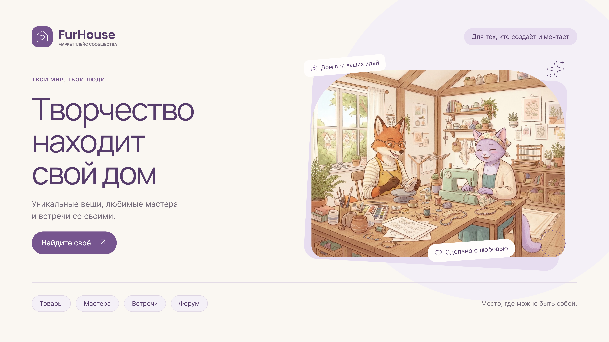

---

## 📋 Содержание

- [Описание](#описание)
- [Возможности](#возможности)
- [Роли пользователей](#роли-пользователей)
- [Скриншоты](#скриншоты)
- [Стек технологий](#стек-технологий)
- [Структура проекта](#структура-проекта)
- [Установка](#установка)
- [Запуск](#запуск)
- [База данных](#база-данных)
- [Лицензия](#лицензия)

---

## 📖 Описание

FurHouse решает проблему разрозненности фурри-сообщества: сейчас мастера продают работы через разные платформы, встречи организуются в чатах, а поиск услуг затруднён. Проект объединяет всё в одном месте с модерацией, верификацией мастеров и безопасными сделками.

**Целевая аудитория:**
- Художники и мастера (продажа работ и услуг)
- Организаторы встреч и фестивалей
- Покупатели и коллекционеры
- Модераторы сообщества

---

## ✨ Возможности

### 🛍️ Маркетплейс
- Каталог товаров с фильтрацией по категориям
- Карточки товаров с галереей изображений
- Система рейтингов и отзывов
- Избранное (polymorphic связь)
- Корзина и оформление заказов

### 🎨 Услуги мастеров
- Каталог услуг с категориями (арт, костюмы, 3D, музыка)
- Обсуждение заказа через встроенный чат
- Модерация услуг перед публикацией

### 🎉 Встречи и события
- Афиша мероприятий по городам
- Запись на встречи с лимитом участников
- Разные типы: прогулки, пикники, фестивали
- Модерация событий

### 💬 Форум
- Доски по тематикам (/art/, /craft/, /meet/)
- Треды с модерацией
- Система "лучший ответ"
- Закреплённые и избранные темы

### 🛡️ Поддержка и безопасность
- Система обращений с чатом
- Назначение обращений персоналу
- Журнал активности с IP-адресами
- Объявления для команды

### 👑 Админ-панель
- Управление пользователями и ролями
- Верификация мастеров и организаторов
- Система ограничений (can_post_*)
- Модерация контента
- Статистика и аналитика

---

## 👥 Роли пользователей

| Роль | Возможности |
|------|-------------|
| **Гость** | Просмотр каталога, регистрация |
| **Пользователь** | Покупка, избранное, обращения, форум |
| **Мастер** | Размещение услуг, чат с клиентами |
| **Организатор** | Создание встреч, управление участниками |
| **Модератор** | Модерация контента, обработка обращений |
| **Администратор** | Полный доступ, управление ролями |

---

## 📸 Скриншоты

### Главная страница
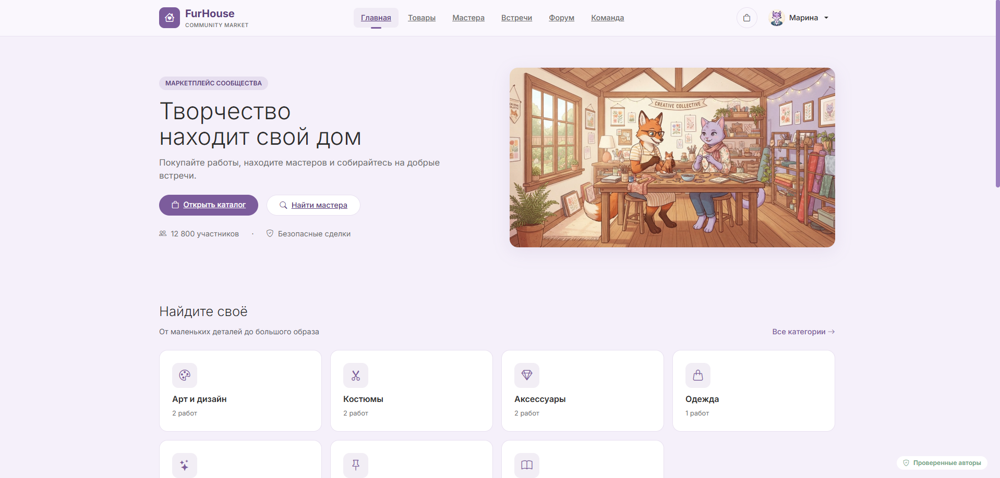

### Каталог товаров
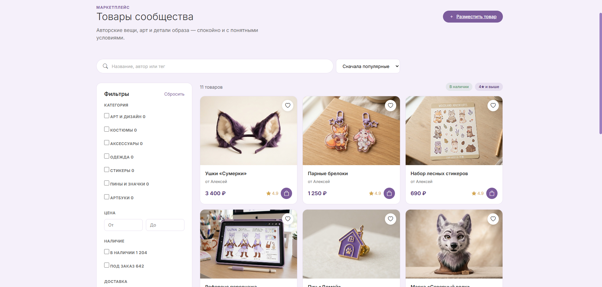

### Страница товара
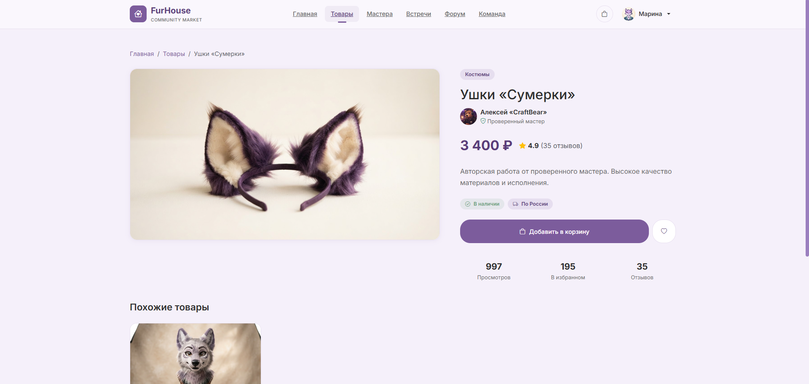

### Услуги мастеров
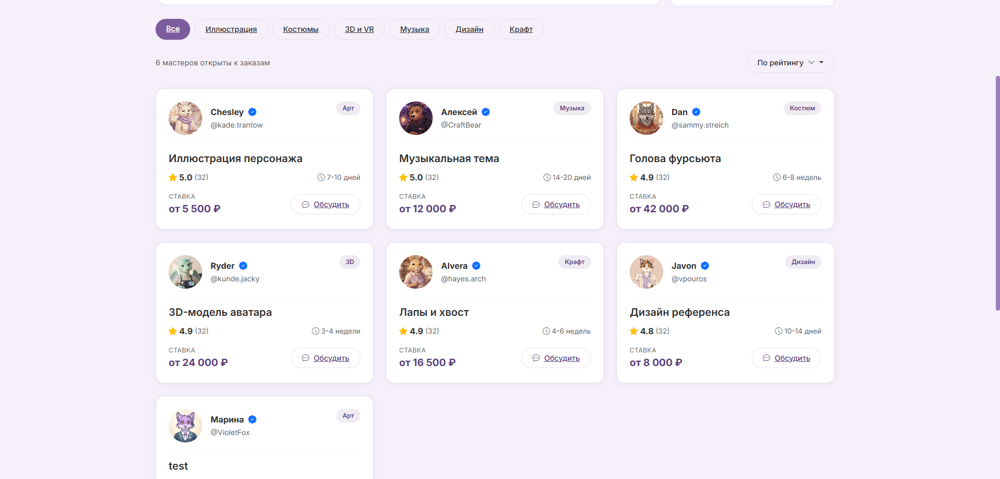

### Встречи
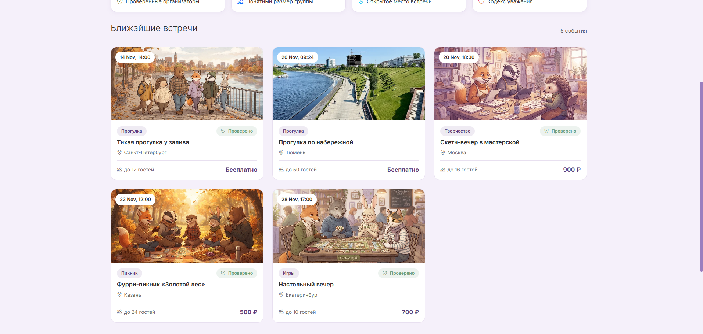

### Форум
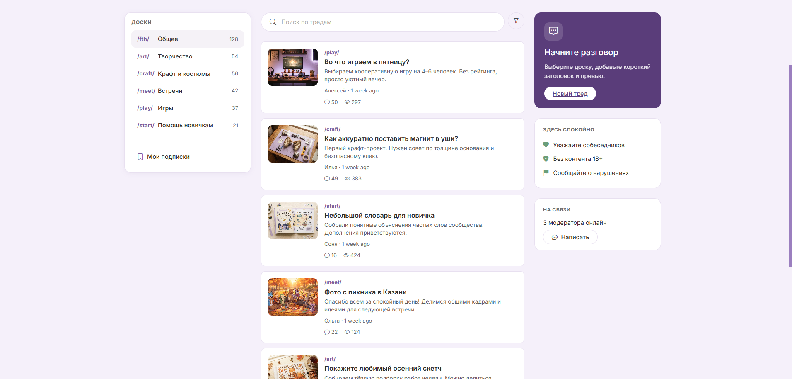

### Корзина
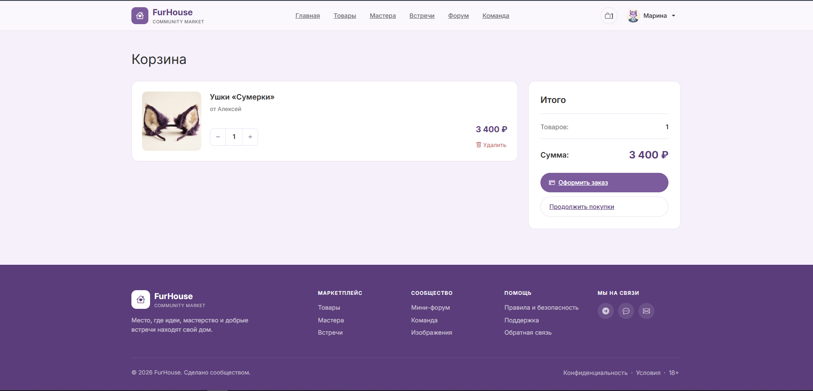

### Профиль пользователя
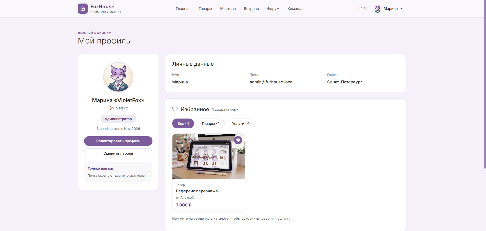

### Чат обращений
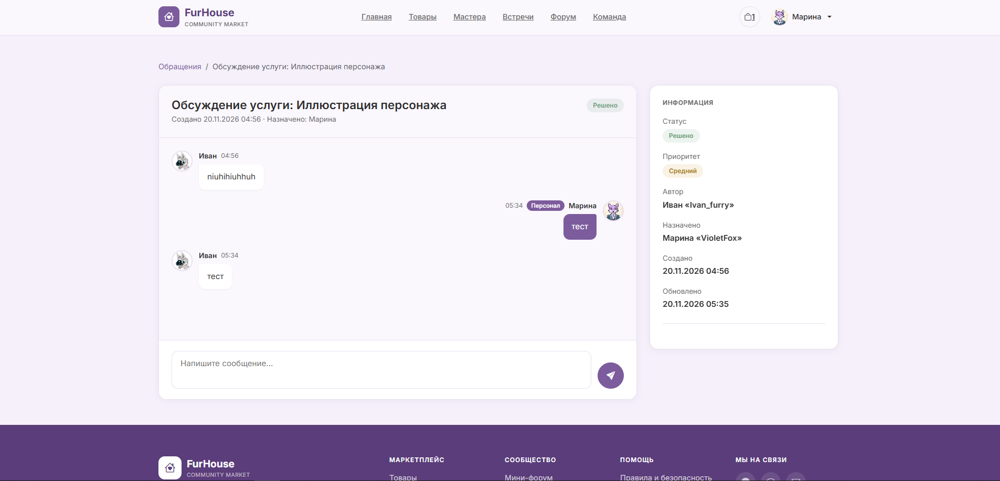

### Админ-панель
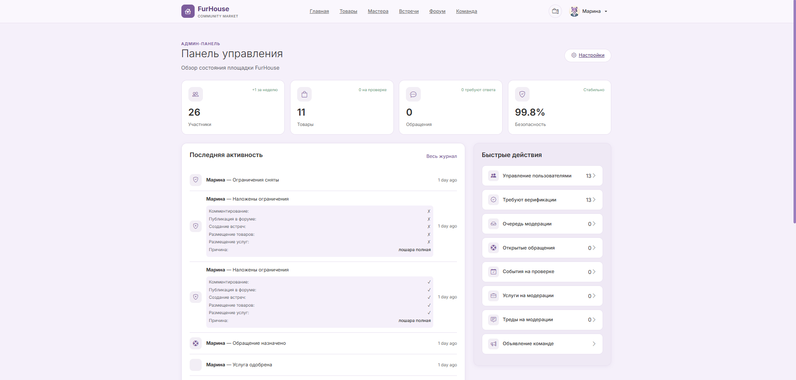

### Управление пользователями
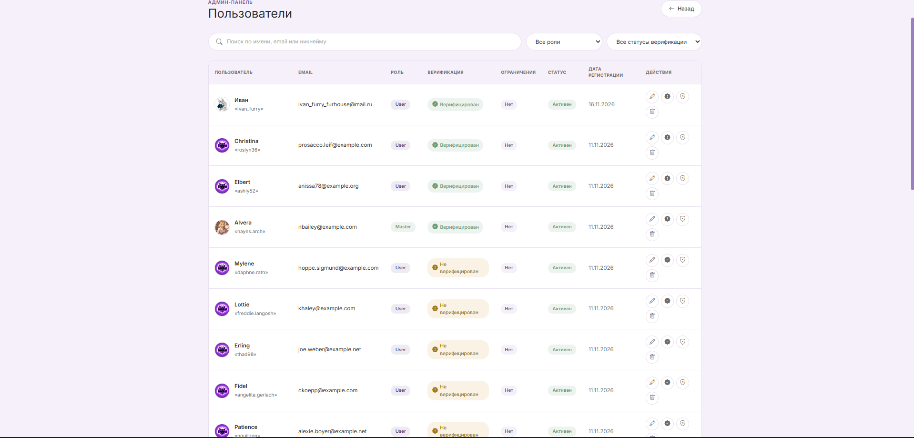

### ER-Диаграмма из Mermaid.live
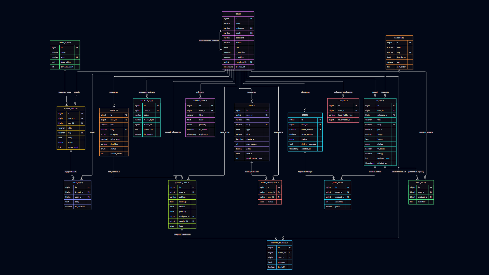